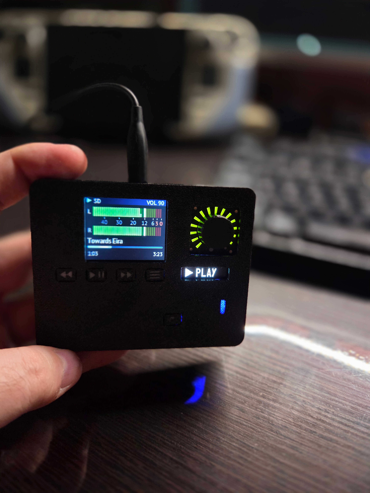

# ESP32-S3 Audio Player

**English** | [Русский](README.ru.md)

A portable MP3 player on the ESP32-S3 that plays music from a microSD card or streams it from a
DLNA/UPnP media server (tested with Synology Audio Station). It has a 1.8" colour TFT with four
screen modes, a small OLED status display, a rotary encoder with a 16-LED ring and four
buttons, and an output compressor and limiter that keep the DAC from being overdriven.



## Features

- **Two sources.** microSD (folder browser, playlist = folder) and DLNA (browse the server's
  ContentDirectory, stream tracks over HTTP).
- **Four screens on the TFT.** Track card with a small cover, segmented VU bars with peak hold,
  analogue-style needle VU meters (L/R, ~300 ms ballistics), and a full-screen album cover.
- **Album art.** JPEG from the ID3 `APIC` frame (SD) or the DLNA `albumArtURI` (network).
- **Tags.** ID3v2.3/2.4 in UTF-16, UTF-8, Latin-1 and Windows-1251 (Cyrillic is displayed).
- **Smooth fonts.** PT Sans (anti-aliased, Latin + Cyrillic) generated as VLW fonts.
- **Network buffer.** 256 KB ring buffer in PSRAM, filled by a separate task, so short WiFi
  drop-outs are not audible.
- **Output dynamics.** Volume in dB, then a ReaComp-style compressor (RMS detector, ∞:1 by
  default) and a brick-wall lookahead limiter. Both sit after the volume control, so they only
  act when the output is actually loud.
- **Status OLED.** Large ▶ / ❚❚ / ■ icon with PLAY / PAUSE / STOP, and ↻1 when repeat-one is on.
- **LED ring around the encoder.** 16 LEDs driven through an MCP23017: volume on LEDs 1–15,
  the red 16th LED for pause or mute, the cursor position in the browser.
- **Remembers state.** Volume, repeat, screen mode, last source, folder and track are kept in NVS
  and restored on boot.

## Repository layout

```
case/       STL files for the 3D-printed enclosure
docs/       photos
firmware/   Arduino sketch (open firmware/firmware.ino)
```

The enclosure parts in `case/`:

| File | Part |
|---|---|
| `case_front.stl` | front panel; the board mounts on its standoffs |
| `case_rear.stl` | rear cover, snaps onto the front |
| `keys_caps.stl` | button caps |
| `keys_symbols.stl` | symbol inlays for the button caps |
| `knob.stl` | encoder knob |

## Hardware

| Part | Notes |
|---|---|
| ESP32-S3-DevKitC, **N16R8** (16 MB flash, 8 MB OPI PSRAM) | PSRAM is required |
| PCM5102A DAC module (purple "GY" board) | I²S, hardware mode |
| ST7735S 1.8" TFT, 128×160, SPI | the red module; its SD slot is not used |
| SSD1306 OLED 0.91", 128×32, I²C | status display |
| microSD module, SPI | FAT32 card |
| Rotary encoder with push switch and a 16-LED ring | ring is a 4×4 matrix: 4 cathodes + 4 anodes |
| MCP23017 I²C GPIO expander (CJMCU module) | drives the LED ring |
| 4 tactile buttons | to GND |
| IP5306 charger/boost module + LiPo | 5 V supply |

### Wiring

| Function | ESP32-S3 GPIO |
|---|---|
| TFT (FSPI) | SCK 18, MOSI 9, CS 10, DC 13, RST 4, backlight 2 |
| microSD (SPI3, separate bus) | SCK 40, MISO 42, MOSI 41, CS 5 |
| PCM5102A (I²S) | BCK 14, LRCK 12, DIN 11, XSMT 39 |
| OLED + MCP23017 (shared I²C bus) | SDA 21, SCL 47 |
| Encoder | A 15, B 16, SW 17 |
| Buttons | PREV 1, NEXT 6, PLAY 7, MODE 8 |

Buttons and the encoder switch connect the GPIO to GND; internal pull-ups are used.

**MCP23017 module.** VCC to 3.3 V (not 5 V), A0/A1/A2 to GND (address 0x20), RESET to 3.3 V.
NC/CS, NC/SO and the ITA/ITB interrupt pins stay unconnected. The I²C pull-ups on the OLED
module are enough for the shared bus. The LED ring goes to port A: in this build the ring's
anodes (ring pins 5–8) are on GPA0–3 and the cathodes (ring pins 1–4) on GPA4–7. With another
wiring, change `RING_ANODE_BIT` / `RING_CATH_BIT`. Each cathode sinks up to four LEDs at once,
so keep the LED current at about 5 mA (220–330 Ω on the anode lines if the ring has no resistors).

**Do not use** on the N16R8 DevKitC: GPIO 0, 3, 45, 46 (strapping), 19/20 (USB D−/D+),
35–37 (OPI PSRAM), 38 (on-board RGB LED), 43/44 (UART console). GPIO 22–27 and 32 are not
broken out.

**PCM5102A "GY" module.** Bridge the pads H1L (FLT → normal latency), H2L (DEMP → off) and
H4L (FMT → I²S). Leave **H3L open** and wire XSMT to GPIO 39 so the firmware can unmute the DAC
after the I²S clock is stable. Tie the module's SCK pin to GND (no master clock). Power VIN from 5 V.

**TFT backlight.** The LED pin must be driven (GPIO 2, PWM). If it floats, the screen stays
almost black and looks dead.

## Building

**Arduino IDE → Tools:**

| Setting | Value |
|---|---|
| Board | ESP32S3 Dev Module |
| Flash Size | 16MB |
| Flash Mode | QIO 80MHz |
| PSRAM | **OPI PSRAM** |
| Partition Scheme | 16M Flash (2MB APP/12.5MB FATFS) |
| USB CDC On Boot | Disabled (console on the UART port) |

ESP32 Arduino core **3.3.x** (built and tested with 3.3.12). The firmware is about 1.44 MB.

**Libraries:**
[arduino-audio-tools](https://github.com/pschatzmann/arduino-audio-tools),
[arduino-libhelix](https://github.com/pschatzmann/arduino-libhelix),
[LovyanGFX](https://github.com/lovyan03/LovyanGFX),
[U8g2](https://github.com/olikraus/u8g2).

### Files in `firmware/`

| File | Purpose |
|---|---|
| `firmware.ino` | empty stub, so the folder opens in the Arduino IDE |
| `player.cpp` | all of the firmware (plain C++, no Arduino prototype generation) |
| `compressor.h` | ReaComp-style compressor |
| `limiter.h` | lookahead brick-wall limiter |
| `fonts.h` | PT Sans VLW fonts (generated) |
| `secrets.example.h` | template for `secrets.h` |
| `secrets.h` | your WiFi password and DLNA server, **not committed** |

### Configuration

In `firmware/`, copy `secrets.example.h` to `secrets.h` and fill it in:

```cpp
#define WIFI_SSID         "your-ssid"
#define WIFI_PASS         "your-password"
#define DLNA_CONTROL_URL  "http://192.168.1.10:50001/ContentDirectory/control"
#define DLNA_NAME         "My NAS"
```

`DLNA_CONTROL_URL` is the server's ContentDirectory control URL. For Synology Audio Station it is
`http://<nas-ip>:50001/ContentDirectory/control`. For other servers, read it from the device
description XML (the `LOCATION` header of the server's SSDP reply).

The other settings are `#define`s at the top of `player.cpp`:

| Setting | Default | Meaning |
|---|---|---|
| `NET_BUFFER_KB` | 256 | network ring buffer in PSRAM |
| `NET_PREFILL_KB` | 24 | data to buffer before a track starts |
| `TFT_BRIGHTNESS` | 200 | backlight, 0–255 |
| `VU_REF_DBFS` | −12 | RMS level shown as 0 VU on the needle meters |
| `VOL_MAX_DB` / `VOL_RANGE_DB` | 0 / 60 | volume scale: VOL 100 = 0 dB, 0.6 dB per step |
| `COMP_*` | see below | compressor |
| `LIM_*` | see below | limiter |
| `DIAG_LEVELS` | 1 | print `[LVL]` level diagnostics once a second |
| `RING_*` | see below | LED ring |

## Controls

| Control | Player | Browser |
|---|---|---|
| Encoder turn | volume | scroll |
| Encoder click | play / pause | open folder / play |
| Encoder double click | repeat one on/off | back |
| Encoder long press | open browser | close browser |
| PREV | previous track (after 3 s: restart track) | back |
| PREV long | stop | — |
| NEXT | next track | open / play |
| NEXT long | repeat one on/off | — |
| PLAY | play / pause | play / pause |
| PLAY long | stop | stop |
| MODE | next screen: card → VU bars → VU needles → cover | close browser |
| MODE long | open browser | close browser |

The browser starts at *Library* with two entries: **SD card** and the **DLNA server**. Opening a
track plays it and the rest of its folder.

### LED ring

| State | Ring |
|---|---|
| Playing | volume bar on LEDs 1–15 (VOL 100 = all 15) |
| Paused, or volume 0 | only the red 16th LED |
| Stopped | a single LED at the volume level |
| Browser | a single LED showing the position in the list |

| Setting | Default | Meaning |
|---|---|---|
| `RING_ENABLE` | 1 | turn the ring on or off |
| `RING_ADDR` | 0x20 | MCP23017 I²C address |
| `RING_CATH_BIT` / `RING_ANODE_BIT` | 4 / 0 | first port A bit of the 4 cathodes / 4 anodes |
| `RING_TEST` | 0 | 1 = at boot, light all 16 LEDs one by one and print their matrix numbers |
| `RING_ORDER` | 0…15 | matrix number for each position around the ring (fill from the test) |
| `RING_REVERSE` | 0 | 1 = run the bar the other way round |

The ring is multiplexed one cathode at a time, 2 ms each (125 Hz frame rate), from its own
task. Driving it from `loop()` would make it flicker while the TFT frame is being sent.

## Audio chain

```
SD / DLNA ─► MP3 decoder (Helix) ─► volume (dB, smoothed) ─► compressor ─► limiter ─► I²S ─► PCM5102A
                                                                                    └─► VU meters
```

The compressor and the limiter run **after** the volume control: their thresholds are levels at
the DAC input. At low volume nothing is touched; at high volume they stop the output from being
overdriven.

**Compressor** (`compressor.h`), knobs as in Cockos ReaComp. The default is ReaComp used as a
limiter:

| Setting | Default |
|---|---|
| `COMP_THRESH_DB` | −9 dB |
| `COMP_RATIO` | 0 (= ∞:1) |
| `COMP_KNEE_DB` | 0 |
| `COMP_ATTACK_MS` / `COMP_RELEASE_MS` | 3 / 150 ms |
| `COMP_AUTO_RELEASE` | 0 |
| `COMP_RMS_MS` | 5 ms (0 = peak detector) |
| `COMP_PRECOMP_MS` | 0 (lookahead) |
| `COMP_MAKEUP_DB` | 0 |

Auto release uses a common two-envelope, program-dependent scheme. ReaComp's own algorithm is not
public, so it behaves similarly but not identically.

**Limiter** (`limiter.h`), knobs as in Cockos ReaLimit. Everything above `LIM_THRESH_DB` is
limited, then the whole signal is shifted by `LIM_CEIL_DB − LIM_THRESH_DB`, so output peaks equal
the ceiling. The default is −1.5 / −1.5 dBFS, lookahead 3 ms (= attack), release 120 ms. Output
samples never exceed the ceiling, and signal below the threshold passes unchanged.

A red **LIM** label in the TFT status bar lights up while either stage reduces gain by more than
0.5 dB. With `DIAG_LEVELS 1` the serial console prints, once a second:

```
[LVL] VOL 100 (0.0 dB)  peak  -6.1 dBFS  comp  -3.2 dB  limiter   0.0 dB  clipped 0
```

## Architecture

- **Core 0, `audioTask`:** owns `AudioPlayer`. All playback commands arrive through a queue, so
  the player is only ever touched by one task.
- **Core 0, `netfill`:** reads the HTTP stream into the PSRAM ring buffer.
- **Core 1, `loop()`:** buttons, encoder, both displays, file and DLNA browser, cover loading
  and decoding, NVS.
- **Core 1, `ring`:** multiplexes the LED ring over I²C. Arduino `Wire` locks each transaction,
  so the ring and the OLED share the bus safely.

## Troubleshooting

| Symptom | Cause / fix |
|---|---|
| TFT dark, faint glow | backlight pin not driven; it must be GPIO 2 |
| Wrong colours (gold looks blue) | panel is BGR: `cfg.rgb_order = true` (already set) |
| Noise on the TFT that disappears when you touch the wires | long wires: lower `freq_write` (16 MHz set) or add 33–47 Ω in series with SCK |
| WiFi hangs or `AUTH_FAIL` with a correct password | out of **internal** RAM. Big buffers must live in PSRAM; check the `[MEM]` lines at boot |
| Random resets, `Cache error`, heap asserts while streaming | weak supply: WiFi draws current spikes. Use a solid 5 V source and 470–1000 µF near the board |
| Silence from the DAC | XSMT low, SCK not tied to GND, or a poorly soldered jack on the module |
| `[SD] FAILED` | wiring of the separate SD bus (40/41/42, CS 5) or the card is not FAT32 |
| `[RING] MCP23017 not found` | A0/A1/A2 not tied to GND, RESET not tied to 3.3 V, or no power on the module |
| Ring test runs but no LED lights up | anodes and cathodes swapped: exchange `RING_CATH_BIT` and `RING_ANODE_BIT` |

## Limitations

- MP3 only (AAC and FLAC decoders exist in AudioTools but are not wired in yet).
- Up to 256 entries per folder or DLNA container.
- Fonts cover Latin, Latin-1 and Cyrillic; other scripts show as missing glyphs.
- Progressive JPEG covers are not supported by the decoder.

## Third-party components

- [arduino-audio-tools](https://github.com/pschatzmann/arduino-audio-tools) (GPLv3) and
  [arduino-libhelix](https://github.com/pschatzmann/arduino-libhelix) by Phil Schatzmann
- [LovyanGFX](https://github.com/lovyan03/LovyanGFX) (FreeBSD license)
- [U8g2](https://github.com/olikraus/u8g2) (BSD 2-clause)
- PT Sans by ParaType, [SIL Open Font License 1.1](https://openfontlicense.org)
